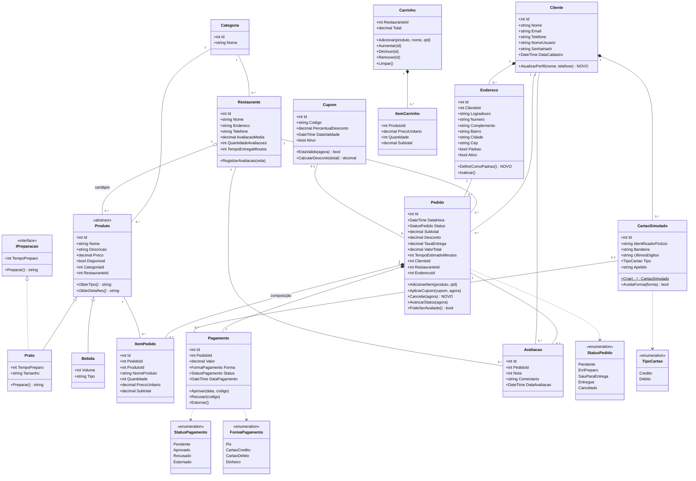
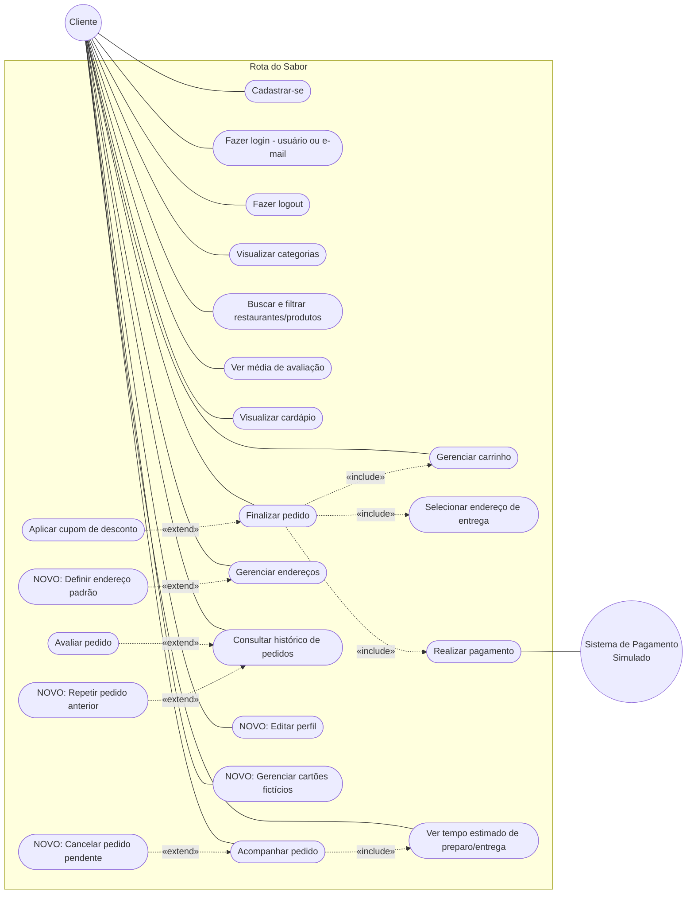

# Diagramas em Mermaid

Mesmo conteúdo dos arquivos `.puml` (PlantUML). As imagens `classes.png` e `casos-de-uso.png` foram geradas a partir destes códigos. Para editar: cole o código em https://mermaid.live ou abra este arquivo no VS Code/GitHub.

## Diagrama de classes

## Diagrama de casos de uso

